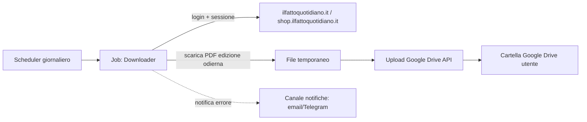

# Technical Specification — Download Automatico "Il Fatto Quotidiano" → Google Drive

Stato: **VALIDATO** (2026-11-17). Decisioni finali riportate nella sezione 10.

## 1. Obiettivo

Processo automatico, schedulato una volta al giorno, che:
1. Si autentica come abbonato su ilfattoquotidiano.it.
2. Scarica il PDF dell'edizione del giorno corrente dall'archivio `in-edicola/edizione`.
3. Carica il PDF in una cartella dedicata su Google Drive (account personale dell'utente).
4. Gira "a costo zero" (nessun hosting a pagamento) su base quotidiana, senza intervento manuale.

## 2. Analisi del sito sorgente (osservazioni pubbliche)

Dalla pagina `https://www.ilfattoquotidiano.it/in-edicola/edizione/` (accesso **non autenticato**):

- La pagina elenca le copertine delle ultime edizioni (immagine copertina + data, es. `MAR 17 NOVEMBRE 2026`).
- Per un utente **non loggato**, al posto del link di lettura/download compare un link **"ABBONATI"** che punta a `https://shop.ilfattoquotidiano.it/abbonati/`.
- Il login abbonati è gestito su un dominio separato: `https://shop.ilfattoquotidiano.it/login/` (probabile piattaforma e-commerce, es. WooCommerce/WordPress), distinto dal sito editoriale `www.ilfattoquotidiano.it`.
- La pagina presenta un cookie/consent banner (gestione privacy) da gestire/chiudere in automazione.

**Conseguenze pratiche:**
- Non è possibile scoprire l'URL esatto del PDF né la struttura della pagina "da loggato" senza autenticarsi realmente con le credenziali dell'utente (cosa che l'assistente non farà in questa fase).
- È molto probabile che il sito sia renderizzato con JavaScript e protetto da meccanismi anti-bot (es. Cloudflare), quindi un semplice client HTTP (`requests`) potrebbe non bastare: va previsto un **browser headless** (Playwright) che gestisca cookie di sessione, eventuale 2FA/captcha, e redirect tra `shop.` e `www.`.
- **Prima della fase di sviluppo** servirà una sessione "esplorativa" fatta dall'utente stesso (o da un suo script locale, mai con le credenziali passate all'assistente) per individuare: form di login reale, selettori DOM del link/bottone di download PDF, formato dell'URL del PDF una volta autenticati.

## 3. Architettura proposta

### Opzioni per "girare senza costi" (scheduler + esecuzione)

| Opzione | Costo | Pro | Contro |
|---|---|---|---|
| **GitHub Actions** (workflow schedulato `cron`) | Gratis per repo privati/pubblici entro i minuti free tier | Nessun server da mantenere, secrets gestiti in modo sicuro (GitHub Secrets), log integrati | Richiede un repo GitHub; IP del runner pubblico, può essere bloccato da anti-bot più aggressivamente di un IP residenziale |
| **Cron locale** (Mac/NAS/Raspberry Pi dell'utente, sempre acceso) | Gratis (hardware già posseduto) | Pieno controllo, IP "normale" meno soggetto a blocchi | Richiede che il dispositivo resti sempre acceso e raggiungibile |
| **Google Cloud Run Jobs + Cloud Scheduler** (free tier) | Gratis entro soglie free tier mensili | Scalabile, integrazione naturale con Google Drive (stesso account Google) | Setup più complesso, da monitorare per non sforare il free tier |

**Proposta di default:** GitHub Actions (più semplice da mantenere "a costo zero" e senza hardware sempre acceso), con fallback documentato su cron locale se il sito blocca gli IP dei runner GitHub. **Da validare con l'utente.**

## 4. Autenticazione al sito

- Le credenziali (utente/password dell'abbonamento) vengono salvate **solo** come secret cifrati della piattaforma scelta (es. `GitHub Secrets`), mai nel codice o in file di configurazione in chiaro nel repo.
- Automazione del login tramite Playwright (browser headless):
  1. Apertura `https://shop.ilfattoquotidiano.it/login/` (o pagina di login equivalente trovata in fase esplorativa).
  2. Chiusura banner cookie/consenso.
  3. Compilazione campi email/password, submit.
  4. Verifica di login riuscito (es. presenza menu utente / assenza link "ABBONATI").
  5. Riutilizzo dei cookie di sessione per navigare su `www.ilfattoquotidiano.it/in-edicola/edizione/`.
- Gestione esplicita dei casi:
  - Login fallito (credenziali scadute/cambiate) → notifica di errore, nessun retry infinito.
  - Presenza di CAPTCHA/2FA non previsto → notifica di errore e stop (non bypassabile in automazione).
- **Nota legale/ToS:** l'automazione di login e download va verificata rispetto ai Termini e Condizioni d'uso del sito (`termini-e-condizioni-dutilizzo`). Trattandosi di uso strettamente personale da parte di un abbonato regolare, il rischio è considerato basso ma va segnalato come assunzione da validare dall'utente.

## 5. Recupero del PDF dell'edizione odierna

- Identificazione dell'edizione corrente tramite la data odierna (fuso orario Europe/Rome), confrontata con la data mostrata in testa all'archivio (es. `MAR 17 NOVEMBRE 2026`).
- Download del PDF tramite il link/azione disponibile solo da loggato (da individuare in fase esplorativa: potrebbe essere un link diretto `.pdf`, un popup "leggi/scarica", o un visualizzatore che richiede di estrarre l'URL reale dalle chiamate di rete).
- **Idempotenza:** se il PDF del giorno risulta già presente su Google Drive (stesso nome file), il job non lo riscarica/ricarica una seconda volta.
- **Retry:** in caso di assenza momentanea dell'edizione (es. pubblicata in ritardo) o errore di rete, un numero limitato di retry (es. 3 tentativi con backoff) nella stessa esecuzione; se fallisce comunque, notifica e si riprova il giorno successivo.

## 6. Caricamento su Google Drive

- Autenticazione verso Google Drive API con **OAuth2 (account utente)** oppure **Service Account** con cartella condivisa:
  - *OAuth2 utente*: richiede un consenso iniziale una tantum e la gestione/rinnovo di un `refresh token` salvato come secret.
  - *Service Account*: nessuna interazione utente ripetuta, ma la cartella Drive deve essere condivisa esplicitamente con l'email del service account (il file risulterà "di proprietà" del service account salvo configurazioni di Shared Drive).
  - **Proposta di default:** OAuth2 con refresh token salvato come secret (più semplice da avere nel Drive "personale" dell'utente). **Da validare.**
- Cartella di destinazione: da definire (es. `Il Fatto Quotidiano/AAAA/`), creata automaticamente se non esiste.
- Convenzione di naming file: proposta `ilfattoquotidiano_YYYY-MM-DD.pdf`. **Da validare.**
- Verifica integrità upload (dimensione file, eventuale checksum) prima di considerare il job concluso con successo.

## 7. Notifiche e osservabilità

- In caso di **successo**: log (e opzionalmente notifica leggera, es. messaggio Telegram) con link al file caricato.
- In caso di **errore** (login fallito, PDF non trovato, upload fallito): notifica via email o Telegram/altro canale a scelta dell'utente, con dettaglio dell'errore.
- Log di ogni esecuzione conservati (es. come artifact del workflow GitHub Actions) per diagnosi successiva.

## 8. Stack tecnico proposto

- **Linguaggio:** Python 3.
- **Browser automation:** Playwright (gestione login/sessione/eventuale JS rendering).
- **Google Drive:** libreria ufficiale `google-api-python-client` + `google-auth`.
- **Scheduling:** GitHub Actions (`schedule: cron`), orario proposto: dopo la pubblicazione tipica dell'edizione digitale (da confermare, indicativamente mattina presto ora italiana).
- **Secrets:** GitHub Secrets (credenziali sito + refresh token Google Drive).

## 9. Sicurezza

- Nessuna credenziale in chiaro nel codice o nei log.
- Secrets gestiti esclusivamente tramite il meccanismo di secret management della piattaforma di hosting scelta.
- Permessi Google Drive limitati allo scope minimo necessario (`drive.file`, non accesso completo al Drive).
- Repo GitHub (se usato) impostato come **privato**.

## 10. Decisioni finali

1. **Hosting/scheduler:** GitHub Actions, sul repo `mvarisco/DownloadPaper` (già esistente), esecuzione giornaliera via `cron` alle **06:00 Europe/Rome**.
2. **Accesso a Google Drive:** Service Account, con la cartella Drive condivisa in lettura/scrittura con l'email del service account.
3. **Cartella Drive:** già esistente, nome **`ilFattoQuotidiano`** (va recuperato il suo ID cartella e condivisa con l'email del service account una volta creato).
4. **Canale di notifica errori:** Email.
5. **Orario di esecuzione:** 06:00 (Europe/Rome).
6. **Retention:** conservare solo i PDF degli **ultimi 5 giorni** su Drive; il job elimina automaticamente i file più vecchi nella cartella dedicata.
7. **Fase esplorativa login/PDF:** eseguita tramite uno script Playwright locale interattivo (headed, nessuna credenziale passata allo script o in chat); l'utente effettua il login manualmente nel browser aperto dallo script, che osserva solo il traffico di rete e la struttura della pagina per produrre un report tecnico (vedi `exploration/`).

---
Prossimo passo: l'utente esegue lo script in `exploration/` per produrre il report, poi si procede con l'implementazione del job di produzione.
